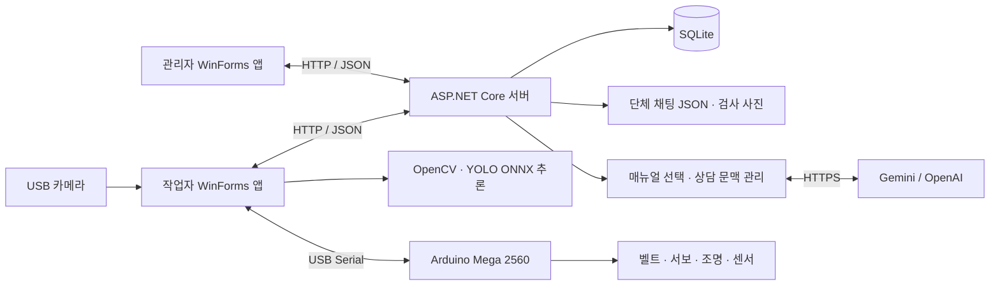

# 생산라인 검사·모니터링 및 AI 상담 시스템

**카메라 검사 결과, 설비 상태, 문제 조치와 현장 소통을 하나의 서버로 연결한 C# 팀 프로젝트입니다.**

컨베이어로 이동하는 휴대폰을 YOLO로 검출하고, 작업자와 관리자가 검사 이력과 설비 문제를 함께 관리합니다. 작업자는 매뉴얼을 참고하는 AI 상담으로 점검 순서를 안내받고, 관리자 상담이나 단체 채팅으로 조치 내용을 공유할 수 있습니다.

| 구분 | 내용 |
|---|---|
| 프로젝트 형태 | 5인 팀 프로젝트 · Windows 데스크톱 앱 + 서버 + Arduino |
| 본인 담당 | **AI 상담·매뉴얼, 단체 채팅, 관리자 상담 및 작업자 화면 연동** |
| 팀 공통 구현 | 관리자/작업자 앱, 서버·DB·통신, 영상처리·모델 학습, 하드웨어 연동 |
| 주요 언어 | C#, Python, Arduino C++ |
| 공개 범위 | 소스·모델·샘플·설정 예시. 실행 중 생성된 DB·채팅·검사 사진·API 키는 제외 |

> 본 문서는 현재 소스 기준으로 작성했습니다. `docs/`와 각 모듈의 기존 문서에는 개발 중간 버전의 설명도 남아 있습니다. [문서 안내](docs/portfolio/PROJECT_ANALYSIS.md#문서의-기준)를 참고해 주세요.

## 1. 개발 목적

검사 화면, 장비 제어, 문제 조치 기록이 분리되면 작업자와 관리자가 같은 상황을 파악하기 어렵습니다. 이를 해결하기 위해 검사 결과와 현장 상태를 서버에서 공유하고, 문제 발생부터 관리자 종결까지의 흐름을 연결했습니다.

AI 상담은 등록된 매뉴얼에서 점검 근거를 찾아 안내하는 보조 기능입니다. 검사 판정은 영상처리 모듈이 담당하고, 실제 장비 조작과 문제 종결은 작업자·관리자 기능으로 구분했습니다.

## 2. 사용 기술과 개발 환경

| 영역 | 기술 및 용도 |
|---|---|
| 데스크톱 | C# / .NET 8 / Windows Forms · 관리자·작업자·학습 도구 |
| 서버 | ASP.NET Core Minimal API · HTTP REST / JSON |
| 데이터 | Entity Framework Core 8.0.32 / SQLite · 계정·라인·검사·문제·상담 이력 |
| 영상처리 | OpenCvSharp4 4.13.0.20260627 · 카메라 프레임 처리·결과 이미지 |
| 모델 추론 | Microsoft.ML.OnnxRuntime 1.24.4 · YOLO ONNX 추론 |
| 모델 학습 | Python / Ultralytics · 라벨 데이터 학습·ONNX 변환 |
| 생성형 AI | Gemini 기본 제공자, OpenAI 대체 제공자 · 서버 측 호출 |
| 장비 통신 | System.IO.Ports 8.0.0 · USB Serial 9600 baud |
| 하드웨어 | Arduino Mega 2560 · PUL/DIR 컨베이어, 서보, 조명, DHT11, MQ-9 |
| 개발 도구 | Visual Studio 2022, .NET SDK, Arduino CLI 1.5.1 |

Python은 학습할 때 필요하며, 배포된 ONNX 모델을 실행하는 C# 검사 앱에는 Python이 필요하지 않습니다. 패키지 버전은 각 `.csproj`가 기준입니다.

## 3. 주요 기능과 구현 방식

### 관리자·작업자 운영

- 로그인 후 역할과 허용 라인을 확인합니다. 서버는 요청마다 현재 계정 상태와 라인 권한을 다시 검사합니다.
- 관리자는 다중 라인 현황, 검사 이력·사진·통계, 사용자와 라인 권한을 관리합니다.
- 작업자는 대표 라인의 카메라 검사, 벨트 연결·구동, 장비 상태와 조치 내용을 확인합니다.
- 1번 라인은 실제 장비용이며 2~4번 라인은 시연용 가상 라인입니다.

### YOLO 검사와 결과 기록

- OpenCV로 받은 영상을 ONNX Runtime에서 추론하고 기종·검출 박스·신뢰도를 표시합니다.
- 현재 `best.onnx`는 640×640 입력의 6개 클래스 통합 모델입니다. `_crack` 클래스를 파손으로 처리하고, 지원되는 기종과 파손 검출 결과로 정상·불량·판정 불가를 구분합니다.
- 목표 검사 간격은 100ms이며 실제 처리 속도는 PC와 모델에 따라 달라집니다.
- 제품이 검출되지 않는 구간을 이용해 다음 제품을 구분하고, 검사 요청 ID로 서버 재전송에 따른 중복 집계를 방지합니다.
- 검사 결과와 당시 JPEG 사진을 연결해 이력에서 조회합니다.

현재 방식은 **이동 중 연속 검사**입니다. 제품을 인식할 때마다 벨트를 정지시키는 방식이 아니며, 설정에 따라 인식 후 가속과 불량 분류를 예약합니다.

### Arduino 제어·센서·원격 운영

- 작업자 앱에서 COM 포트 연결과 Mega 펌웨어 업로드를 지원합니다.
- USB 시리얼 명령으로 벨트, 조명, 서보를 제어하고 온습도·가스 원시값·긴급정지 상태를 수집합니다.
- 관리자의 원격 명령은 서버를 거쳐 해당 작업자 앱이 처리하고 결과를 회신합니다. 작업자 연결 만료와 명령 만료를 구분합니다.
- 불량 분류는 이동·유지 시간을 바탕으로 예약하며, 인식 이벤트 ID로 중복 예약을 막습니다.
- 센서 값은 두 앱의 그래프로 공유합니다. MQ-9의 A0 값은 ADC 원시값이며 ppm 농도가 아닙니다.

현재 핀과 프로토콜은 [Mega V7 안내](hardware/ConveyorYoloControl/README.md)를 참고하세요.

### 문제 처리와 관리자 상담

문제 상태는 다음 순서로 변경합니다.

```text
발생 → 확인 → 조치 중 → 완료 요청 → 관리자 종결
                                  └→ 반려 → 조치 중
```

작업자는 상태를 순서대로 변경하고, 관리자는 완료 요청을 종결하거나 사유를 남겨 반려합니다. 화면에서 “관리자 채팅”으로 표시하는 상담은 **문제 ID별 대화**입니다. 작업자는 조치 중에 메시지를 전송할 수 있고, 문제를 바꿔도 작성 중이던 초안이 유지됩니다. 특정 두 계정만 접근하는 별도 개인 메신저로 구현한 것은 아닙니다.

### 매뉴얼 기반 AI 상담 — 담당 기능

1. 질문의 키워드와 이전 상담 문맥으로 `Manuals.json`의 관련 자료를 선택합니다.
2. 매뉴얼·현재 질문·최근 대화와 확인 가능한 장비 보고를 서버에서 AI에 전달합니다.
3. 답변과 함께 반환된 매뉴얼 ID를 검증하고 실제 등록 자료의 출처를 표시합니다.
4. 자료에 근거가 없는 질문은 범위 밖으로 안내합니다. 연결 실패·시간 초과·호출 한도 초과 시 기본 매뉴얼 답변을 제공합니다.

벡터 DB나 임베딩 검색을 사용하지 않고 **키워드·문맥 기반 자료 선택과 구조화 응답 검증**으로 구현했습니다. 질문 전에 문제를 등록하지 않아도 상담할 수 있습니다.

상담 화면에는 서버 연결 상태, 실제 AI 응답 성공 여부와 왕복 응답 시간이 표시됩니다. “연결 확인”은 서버 접근과 설정 준비 상태를 확인하며, 실제 외부 AI 성공은 질문에 대한 응답을 받은 뒤 표시합니다.

장비 진단은 기존 작업자·보드의 최근 보고를 읽습니다. 센서 미수신·오래된 값과 현재 값을 구분하고, 상담 로직이 COM 포트나 모터를 직접 조작하지 않도록 했습니다.

### 단체 채팅 — 담당 기능

- 관리자·작업자 공통 `GroupChatPanel`을 두 앱에서 링크해 사용합니다.
- 2초마다 마지막 수신 ID 이후의 메시지만 조회하는 HTTP 폴링 방식입니다.
- 전송 ID(`ClientMessageId`)를 유지해 같은 메시지 재시도로 중복 저장되는 문제를 방지합니다.
- 서버는 최근 5,000건을 JSON 파일에 저장하며, 파일 저장 성공 후 메모리에 반영합니다.
- 전송 실패 시 입력 내용을 유지하고, 새 메시지 알림과 자동 스크롤을 지원합니다.

### 라벨링·학습 도구

WinForms에서 이미지에 박스를 그려 YOLO 라벨을 저장하고 학습 데이터를 구성합니다. Python Ultralytics 학습을 실행한 뒤 `best.pt`와 `best.onnx`로 내보냅니다. 클래스 구성은 프로젝트별로 변경할 수 있으며, 학습용 기본 클래스와 현재 배포 모델의 클래스는 구분합니다.

## 4. 시스템 구조



| 저장 대상 | 위치·방식 |
|---|---|
| 계정·권한·검사·문제·문제별 상담·통신 기록 | 서버 `App_Data/productionline.db` · SQLite |
| 단체 채팅 | 서버 `data/group-chat.json` |
| 검사 이미지 | 서버 `data/inspection-images/` |
| AI 대화 문맥 | 서버 메모리 · 사용자/라인/상담 ID별 관리 |
| AI 진단 이벤트 | 서버 `data/ai-events.jsonl` · 질문 본문 대신 상태 코드 |
| Gemini 저장 키 | 서버 PC Windows 계정의 LocalAppData · DPAPI 암호화 |

DB와 실행 기록은 서버가 생성하며 저장소에는 포함하지 않습니다.

## 5. 폴더 구조

```text
ProductionLineSystem.sln
00_Shared/        공통 DTO·API 클라이언트·채팅/접속/그래프 UI
01_AdminApp/      관리자 앱
02_UserApp/       작업자 앱·장비 통신·카메라 검사
03_Server/        REST API·인증·DB·상담/채팅 서버 처리
04_Vision/        YOLO ONNX 추론·모델·검사 샘플
05_AiAssistant/   매뉴얼·AI 호출·답변 검증·자동 검증 코드
06_TrainingTool/  라벨링 UI·학습 데이터·Python 학습 실행
hardware/         Mega 펌웨어·필요 라이브러리·라이선스
scripts/          빌드·앱 실행·AI 키 설정
tools/            검증 도구·Arduino CLI·개발 보조 스크립트
docs/portfolio/   현재 분석·담당 역할·공개 범위·검증 기록
```

기존 프로젝트 참조와 연결 경로를 유지하기 위해 번호별 폴더와 솔루션 구조를 보존했습니다. [파일별 코드 안내](docs/portfolio/CODE_MAP.md)에서 전체 구현 위치를 확인할 수 있습니다.

## 6. 실행 방법

### 준비 환경

- Windows, .NET 8 대상 빌드가 가능한 SDK와 Visual Studio 2022의 .NET 데스크톱 개발 구성
- 패키지 복원을 위한 NuGet 접근
- 카메라 검사는 USB 카메라, 장비 제어는 Mega 2560과 실제 장비 연결 필요
- 하드웨어가 없어도 로그인·문제 관리·채팅·기본 매뉴얼 상담은 확인 가능

압축을 사용할 때는 `C:\PL\ProductionLine`처럼 짧은 경로에 풉니다. 원본 실행 안내에서 긴 경로의 네이티브 SQLite DLL 로드 문제가 보고되어 있어 같은 제약을 안내합니다.

### 빌드

저장소 루트에서 실행하거나 `ProductionLineSystem.sln`을 Visual Studio로 엽니다.

```powershell
dotnet restore .\ProductionLineSystem.sln
dotnet build .\ProductionLineSystem.sln -c Release --no-restore
```

### 서버 → 관리자 → 작업자

각각 별도의 터미널에서 실행합니다.

```powershell
# 1. 서버
dotnet run --project .\03_Server\ProductionLine.Server -c Release --no-build --no-launch-profile
```

```powershell
# 2. 관리자
$env:PRODUCTIONLINE_SERVER_URL = 'http://127.0.0.1:5050'
dotnet run --project .\01_AdminApp\ProductionLine.AdminApp -c Release --no-build
```

```powershell
# 3. 작업자
$env:PRODUCTIONLINE_SERVER_URL = 'http://127.0.0.1:5050'
dotnet run --project .\02_UserApp\ProductionLine.UserApp -c Release --no-build
```

서버는 기본 HTTP 5050 포트를 사용합니다. 다른 PC에서는 `127.0.0.1` 대신 서버 PC의 IP를 입력합니다. 접속 창의 서버 자동 검색은 UDP 5051을 사용합니다. 여러 PC가 같은 데이터를 보려면 서버 한 대에 연결해야 합니다.

처음 서버를 실행하면 마이그레이션으로 DB를 만들고 다음 **시연 전용 계정**을 생성합니다.

| 역할 | ID | 시연 비밀번호 |
|---|---|---|
| 관리자 | `admin` | `admin123!` |
| 작업자 | `worker1` | `worker123!` |

위 값은 코드에 공개된 데모 초기값이며 실제 운영 계정으로 사용하지 않습니다. 현재 서버는 프로젝트의 로컬/LAN 시연을 전제로 합니다.

### AI 설정 — 선택

키가 없어도 기본 매뉴얼 상담을 사용할 수 있습니다. 외부 AI를 사용하려면 **서버를 실행하는 터미널**에서 설정한 뒤 서버를 시작합니다.

```powershell
$env:AI_PROVIDER = 'Gemini'
$env:GEMINI_API_KEY = '<본인 API 키>'
# 계정에서 사용할 수 있는 모델로 변경할 때만 지정
$env:GEMINI_MODEL = '<사용 가능한 모델명>'
dotnet run --project .\03_Server\ProductionLine.Server -c Release --no-build --no-launch-profile
```

`GEMINI_MODEL`을 생략하면 현재 코드·설정의 기본 모델을 사용합니다. 이 문서는 특정 모델의 제공 여부를 보장하지 않습니다. 키를 파일에 하드코딩하지 말고 서버 환경 변수로 전달합니다. 기존 `scripts/set-gemini-key.cmd`는 현재 서버 PC의 Windows 계정에 키를 암호화해 한 번 저장하는 기능입니다. 다른 PC로 키가 자동 이전되지는 않습니다.

코드상 OpenAI 제공자도 선택할 수 있습니다. 그 경우 `AI_PROVIDER=OpenAi`, `OPENAI_API_KEY`, 필요한 경우 `OPENAI_MODEL`을 서버 환경에 설정합니다. 이 준비 작업에서는 유료 API를 호출하지 않았습니다.

### 모델·하드웨어·학습

- 실행에 필요한 `04_Vision/models/best.onnx`와 메타데이터·배경 기준 이미지를 함께 유지합니다.
- Mega 업로드 화면을 쓸 때는 `tools/arduino-cli/`와 `hardware/ConveyorYoloControl/` 전체가 필요합니다. 처음 보드 환경을 준비할 때 네트워크 연결과 AVR 코어 설치가 필요할 수 있습니다.
- 학습 도구: `dotnet run --project .\06_TrainingTool\ProductionLine.TrainingTool -c Release --no-build`
- 학습 UI의 Python/YOLO 확인 및 환경 설치 기능을 사용한 뒤, 별도 학습 프로젝트 폴더를 선택합니다. 현재 저장소의 일부 샘플은 전체 학습 데이터셋이 아닙니다.

## 7. 담당 역할과 기술적 성과

팀 전체 시스템 중 **AI 상담과 채팅 기능을 담당**했습니다. 서버·DB·검사 모델 등 팀원 영역과 연결할 때 기존 공통 DTO와 인증 클라이언트 규격을 활용했습니다.

| 담당 작업 | 구현 내용·기술적 성과 | 주요 코드 |
|---|---|---|
| 공정 매뉴얼 | 가스·온습도·벨트·제품 인식·카메라·조명·분류 모터 등 16개 자료 구성 | [Manuals.json](05_AiAssistant/ProductionLine.AiAssistant/Manuals.json) |
| AI 답변 흐름 | 관련 자료 선택, 최근 대화 전달, 동시 요청 직렬화, 시간 초과·호출 제한 처리 | [AiConsultationService.cs](05_AiAssistant/ProductionLine.AiAssistant/AiConsultationService.cs) |
| 답변 근거 검증 | 구조화 응답의 필수 필드와 매뉴얼 ID 검사, 근거 없는 질문 범위 제한 | [AiResponseProtocol.cs](05_AiAssistant/ProductionLine.AiAssistant/AiResponseProtocol.cs) |
| 연결 상태 UI | 설정 준비와 실제 응답 성공 구분, 응답 시간 표시, 장비 보고 확인 | [AiChatStatusPanel.cs](02_UserApp/ProductionLine.UserApp/AiChatStatusPanel.cs) |
| 단체 채팅 | 공통 UI, 증분 조회, 재시도 중복 방지와 초안 유지 | [GroupChatPanel.cs](00_Shared/ProductionLine.ChatUI/GroupChatPanel.cs), [GroupChatStore.cs](03_Server/ProductionLine.Server/Infrastructure/GroupChatStore.cs) |
| 관리자 상담 연동 | 문제별 대화 표시, 상태에 따른 전송 제한, 문제별 작성 중 초안 유지 | [IssueChat.cs](02_UserApp/ProductionLine.UserApp/IssueChat.cs), [IssueConversationPanel.cs](01_AdminApp/ProductionLine.AdminApp/IssueConversationPanel.cs) |

핵심적으로는 “AI 호출이 성공했는가”, “답변에 매뉴얼 근거가 있는가”, “장비의 최신 보고가 있는가”를 별도로 처리했습니다. 또한 메시지 전송 실패 후 재시도 시 기록이 중복되거나 입력 내용이 사라지는 문제를 줄이도록 설계했습니다.

자세한 담당 범위와 팀 기능의 구분은 [담당 역할](docs/portfolio/CONTRIBUTIONS.md)을 참고하세요. 모델 정확도나 생산성 개선율은 측정 근거가 없어 성과 수치로 기재하지 않았습니다.

## 8. 검증과 현재 한계

2026-10-27 업로드 준비본에서 확인했습니다.

| 검증 | 결과 |
|---|---|
| 전체 솔루션 Release 빌드 | 성공 · 오류 0, 경고 0 |
| 기존 AI/매뉴얼/응답 상태 검증 | 196개 검사 통과 · 가짜 HTTP 응답 사용 |
| 기존 원격 상태·프로토콜·인식 타이밍 검증 | 66개 검사 통과 · 모의 장비 사용 |
| 격리 서버 API 검증 | 25개 통과 · 인증·채팅·상태 전이·AI 기본 안내·재시작 후 보존 |
| 기존 전체 원격 UI 통합 검증 | 구형 `ComboBox` 가정과 현재 `DarkComboBox` 타입 불일치로 중단 · 수정 보류 |

검증 시에는 운영 DB·실제 카메라·COM 포트·모터·외부 AI를 사용하지 않았습니다. 물리 장비의 동작과 실제 AI 서비스의 응답 성공을 검증한 결과로 해석하지 않습니다. [검증 기록](docs/portfolio/VALIDATION.md)

- 제품 간 빈 구간을 기준으로 개수를 구분하므로 겹친 제품이나 간격 없는 연속 통과의 정확한 계수는 보장하지 않습니다.
- 분류 위치의 통과 센서가 없어 실제 통과 피드백 대신 설정 시간과 구동 추정으로 분류합니다.
- 일부 학습·발표 보조 스크립트에는 개발 당시 로컬 경로가 남아 있어 재사용 시 인자를 확인해야 합니다.
- AI 대화 문맥·인증 세션·일부 장비 상태는 서버 메모리에서 관리하므로 서버 재시작 시 다시 로그인·상태 보고가 필요합니다.
- 모델의 실제 촬영 환경 성능과 하드웨어 제어는 현장 조건에 맞는 추가 확인이 필요합니다.

## 9. 공개 자료와 라이선스

원본 라이선스가 있는 Arduino 라이브러리와 CLI의 고지 파일을 유지했습니다. 모델의 출처는 `04_Vision/models/model_info.json`에 남겨 두었습니다. 팀 자체 코드의 공개 라이선스는 별도로 확정하지 않았으며, 임의로 MIT 등의 라이선스를 부여하지 않았습니다. [제3자 구성 요소](THIRD_PARTY_NOTICES.md)

업로드에서 제외한 파일과 점검 결과는 [공개 범위·민감정보 점검](docs/portfolio/SECURITY_REVIEW.md)을 참고하세요.
